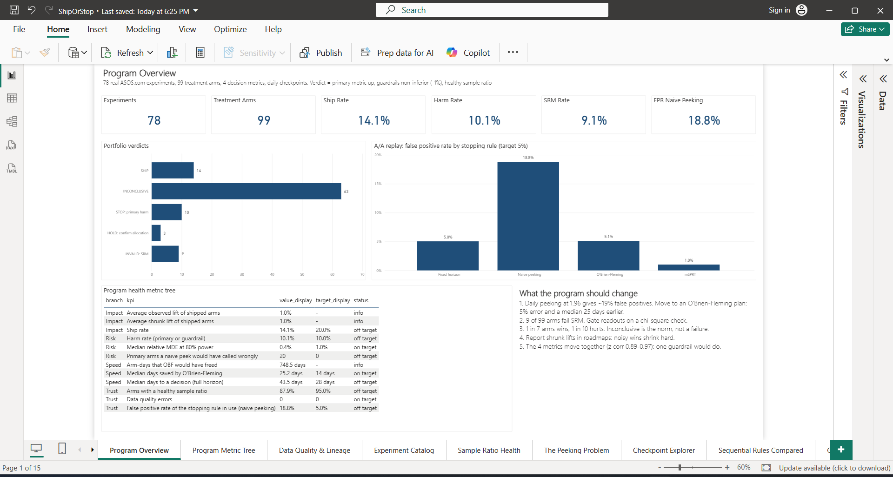
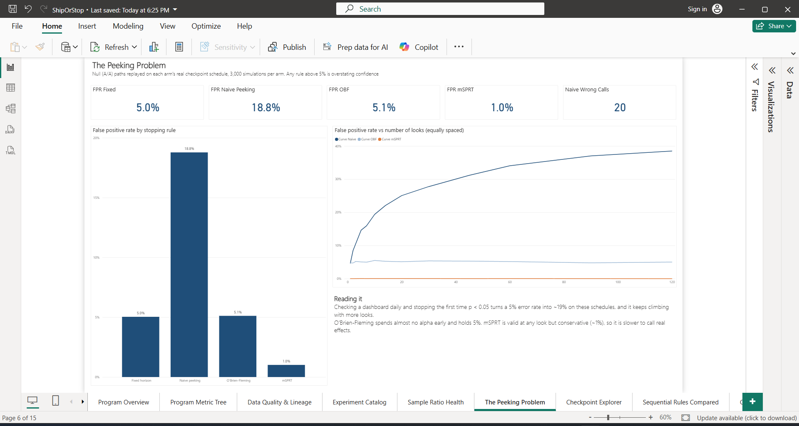
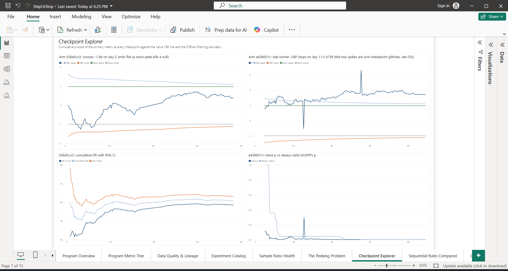
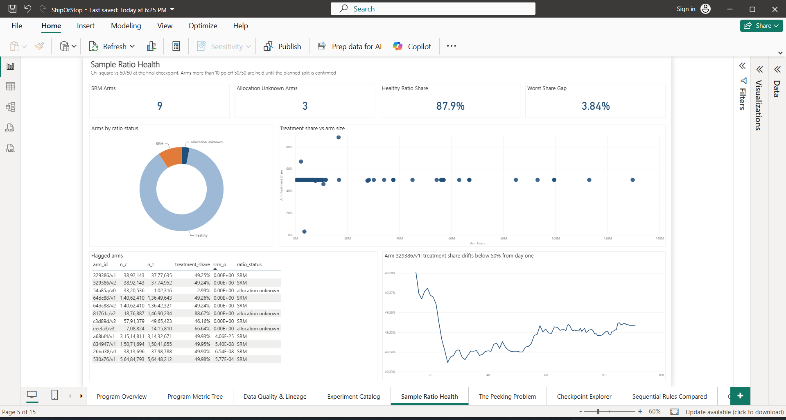
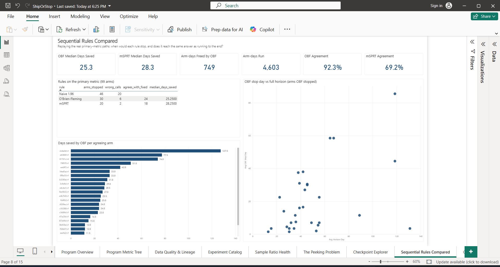
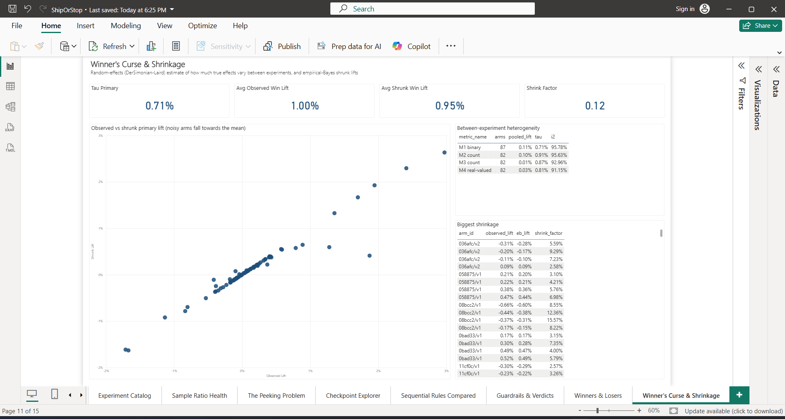
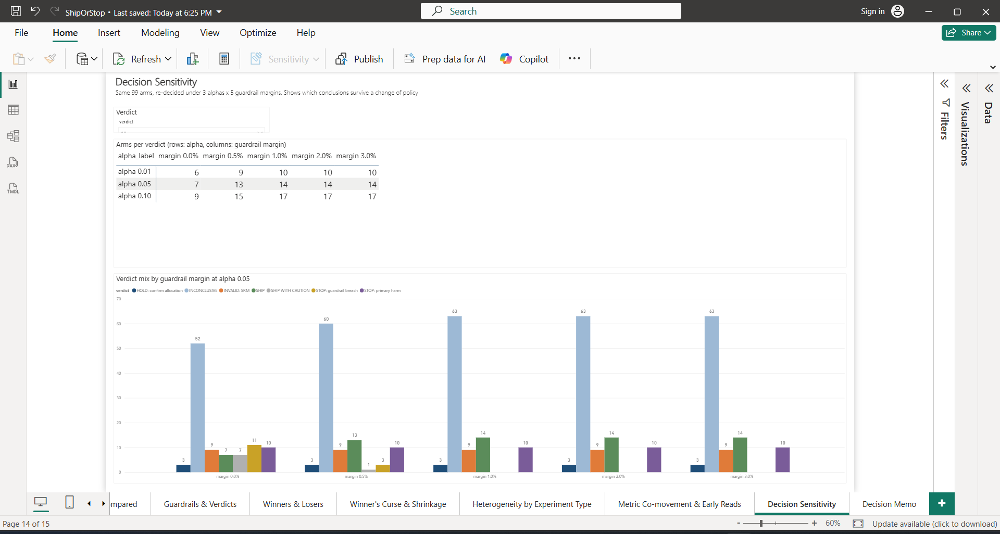
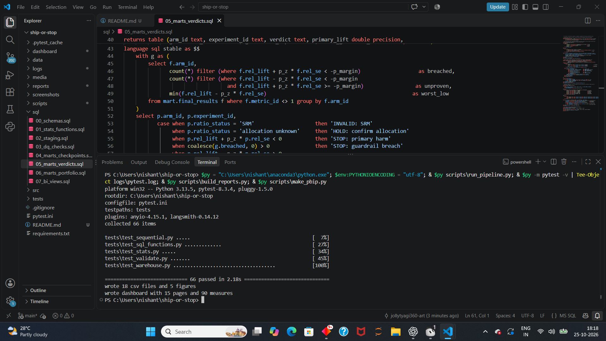

# ship-or-stop

**Experimentation program analytics on 78 real A/B tests from ASOS.com.**
Most A/B-test projects analyse one experiment. This one audits the *program* that runs them. It asks whether
the stopping rule can be trusted, which readouts are broken, how big wins really are, whether the guardrails
earn their keep, and what the experimentation team should change. Everything runs on Postgres, Python and Power BI.



## The short version

| question | answer | where |
|---|---|---|
| Is "stop when the dashboard says p < 0.05" safe? | No. On the real checkpoint schedules it gives an **18.8%** false-positive rate, not 5%. 20 of 99 arms would have been called wrongly. | `mart.null_fpr`, `mart.sequential_stops` |
| What should replace it? | **O'Brien-Fleming**: 5.1% error. It agrees with the full horizon on 24 of 26 significant arms and finishes a median **25 days earlier** (~750 arm-days freed). | `mart.obf_boundary` |
| Can we trust every readout? | **12 of 99** arms can't be trusted: 9 fail SRM (e.g. 49.2% splits on millions of users) and 3 have an unknown planned split. | `mart.srm` |
| What does the portfolio look like? | 14 SHIP, 10 STOP, 63 inconclusive. **1 in 7 wins, 1 in 10 hurts**, and no test of 3 weeks or less shipped. | `mart.verdicts`, `mart.verdict_segments` |
| Are the wins as big as they look? | Only the precise ones. True effects vary by just 0.71% between experiments, so noisy wins shrink hard (+1.87% to +0.41%). | `mart.eb_shrinkage` |
| Do we need 3 guardrails? | Probably not. The 4 metrics' z-scores correlate 0.89–0.97. | `mart.metric_comovement` |

Full argument, owners and caveats: **[reports/decision_memo.md](reports/decision_memo.md)**.

## Data

[ASOS Digital Experiments Dataset](https://osf.io/64jsb/) (Liu, Cardoso, Couturier & McCoy, 2021, CC BY 4.0).
It holds 24,153 rows of cumulative summary statistics (n, mean and variance for control and treatment) at daily
or 12-hourly checkpoints. It covers 78 experiments with 2–5 variants each and 4 anonymised metrics: M1 is binary,
M2 and M3 are counts, and M4 is real-valued and right-skewed. It's one of the few public datasets that records
how experiments **looked while they were running**, which is what makes sequential testing questions answerable.

Decision policy used throughout (my framing, since the metrics are anonymised): **M1 is the primary metric.
M2–M4 are guardrails with a 1% relative non-inferiority margin. The sample ratio must be healthy.**

## Architecture

```mermaid
flowchart LR
    A[OSF parquet<br/>24,153 checkpoints] -->|etl.py + validate.py<br/>13 file checks| B[(raw.asos_checkpoints<br/>raw.load_audit)]
    B -->|02_staging.sql| C[(stg.checkpoints<br/>stg.rejected_checkpoints<br/>stg.arms / stg.experiments)]
    C -->|03_dq_checks.sql| D[(dq.check_results<br/>dq.incidents)]
    C -->|04_marts_checkpoints.sql<br/>z, info fraction, mSPRT, SRM| E[(mart.checkpoint_stats<br/>mart.final_reads<br/>mart.srm)]
    E -->|program.py<br/>Monte Carlo OBF, A/A replay,<br/>DerSimonian-Laird, EB| F[(mart.obf_boundary<br/>mart.null_fpr<br/>mart.eb_shrinkage)]
    E --> G
    F -->|05_marts_verdicts.sql<br/>Holm, BH, guardrails,<br/>stopping replay, sensitivity| G[(mart.final_results<br/>mart.verdicts<br/>mart.sequential_stops)]
    G -->|06_marts_portfolio.sql| H[(mart.program_kpis<br/>mart.metric_tree<br/>mart.verdict_segments ...)]
    H -->|07_bi_views.sql| I[[bi.* 25 views]]
    I -->|import, live refresh| J[Power BI<br/>15 pages, 90 measures]
    J -->|kpi_check.py<br/>DAX vs SQL| K{{41/41 match}}
```



| layer | what it holds | notable SQL |
|---|---|---|
| `stats` | `erfc`, `norm_sf`, `two_sided_p`, `chisq1_sf`, `msprt_lambda`, z table | normal tail in SQL that keeps relative accuracy at p ~ 1e-20, tested against scipy |
| `stg` | typed, de-duplicated checkpoints with look numbers, untestable rows kept aside with a reason | `row_number`/`lag` per series, `distinct on` dedup |
| `dq` | 27 checks (13 on the raw file, 12 in staging, 2 on marts) plus a row-level incident log | error checks stop the pipeline |
| `mart` | per-look z, info fraction, always-valid p, final reads, SRM, Holm/BH, verdicts, stopping replay, sensitivity grid, metric tree, segments, co-movement, early reads | Holm via `max() over (... rows unbounded preceding)`, BH via reverse-ordered running `min()`, a verdict engine as a SQL function called through `cross join lateral` over the policy grid |
| `bi` | 25 flat views for Power BI | no logic, stable names |

## Methods

* **Per-checkpoint inference:** unpooled z on the difference in means, relative lift with a delta-method CI, and
  MDE at 80% power for the sample each arm actually got.
* **Multiplicity:** Holm within each experiment (all its arms x 4 metrics) and Benjamini-Hochberg across the program.
* **Sample ratio:** chi-square vs 50/50 at the final look, plus the share trajectory over time. Arms more than
  10 pp off 50/50 are held as "allocation unknown" rather than called broken.
* **Peeking audit:** for each arm, 3,000 null Brownian paths observed at that arm's *real* information fractions
  (V_final / V_k). The false-positive rate is measured for fixed horizon, naive 1.96 peeking, O'Brien-Fleming and
  mSPRT.
* **O'Brien-Fleming:** boundary c/sqrt(t_k), with c calibrated by Monte Carlo to give exactly 5% overall on
  irregular look schedules.
* **mSPRT:** normal-mixture likelihood ratio (Johari, Pekelis & Walsh), with mixing sd = 1% of the control mean.
  Always-valid p = 1 / running max of Lambda.
* **Heterogeneity and the winner's curse:** DerSimonian-Laird τ² and I² per metric, normal-normal empirical-Bayes
  shrinkage per arm, and win/loss rates by experiment size, length and design.
* **Metric tree:** program health split into Trust, Speed, Impact and Risk, with 12 KPIs, targets and status in SQL.
* **Early read:** correlation and sign agreement between the day-3/7/14/21/28 z-score and the final z-score, for
  every pair of metrics.

## Power BI (15 pages, plain white theme, live import from `bi.*`)

| | |
|---|---|
|  |  |
| The Peeking Problem | Checkpoint Explorer |
|  |  |
| Sample Ratio Health | Sequential Rules Compared |
|  |  |
| Winner's Curse & Shrinkage | Decision Sensitivity |

Pages: Program Overview, Program Metric Tree, Data Quality & Lineage, Experiment Catalog, Sample Ratio Health,
The Peeking Problem, Checkpoint Explorer, Sequential Rules Compared, Guardrails & Verdicts, Winners & Losers,
Winner's Curse & Shrinkage, Heterogeneity by Experiment Type, Metric Co-movement & Early Reads, Decision
Sensitivity, Decision Memo. All 15 are in [`screenshots/powerbi/`](screenshots/powerbi).

* `dashboard/ShipOrStop.pbip` is the source-controlled project (TMDL model and PBIR report, generated by
  `scripts/make_pbip.py` from the live `bi.*` column types).
* `dashboard/ShipOrStop.pbix` is the same report saved from Power BI Desktop after a refresh.
* **KPI cross-check:** `scripts/kpi_check.py` sends one DAX query to the Analysis Services engine inside the
  running Power BI Desktop and compares 41 card measures with SQL written independently against `mart.*`. Result:
  41/41 match to 1e-9 ([reports/kpi_crosscheck.csv](reports/kpi_crosscheck.csv)).

## Build in VS Code



Every step was run from the VS Code integrated terminal (more in [`screenshots/vscode/`](screenshots/vscode)).
The walkthrough video [`media/ship-or-stop-walkthrough.mp4`](media/ship-or-stop-walkthrough.mp4) goes through
the files in VS Code first, then every Power BI page.

## Run it

Needs Python 3.11+, PostgreSQL 16 on localhost and Power BI Desktop (for the dashboard only).

```
pip install -r requirements.txt
python scripts/run_pipeline.py      # downloads the parquet from OSF, builds raw -> bi in ~20 s
python -m pytest                    # 66 tests: stats, sequential, validation, SQL functions, warehouse reconciliation
python scripts/build_reports.py     # reports/*.csv + reports/figures/*.png
python scripts/make_pbip.py         # regenerate dashboard/ShipOrStop.pbip
python scripts/kpi_check.py         # with the report open in Power BI Desktop
```

The connection comes from `PGHOST`, `PGPORT`, `PGUSER` and `SOS_DB` (default `ship_or_stop`). The password
is read by libpq from `pgpass.conf`, and nothing secret is in the repo. In Power BI, enter the Postgres login once
and press Refresh.

## Layout

```
sql/00_schemas.sql            raw, dq, stats schemas; rebuilds stg, mart, bi
sql/01_stats_functions.sql    normal tail, chi-square, mSPRT in SQL
sql/02_staging.sql            typed checkpoints, look numbers, rejected rows
sql/03_dq_checks.sql          12 staging checks + incident log
sql/04_marts_checkpoints.sql  per-look stats, final reads, SRM, glitch detection
sql/05_marts_verdicts.sql     Holm/BH, verdict engine, stopping replay, sensitivity grid
sql/06_marts_portfolio.sql    program KPIs, metric tree, segments, co-movement, early reads
sql/07_bi_views.sql           25 bi.* views
src/shiporstop/               config, db, etl, validate, stats, sequential, program
scripts/                      run_pipeline, build_reports, make_pbip, kpi_check (+ dax_query.ps1)
tests/                        pytest suite
reports/                      decision memo, result tables, figures, kpi cross-check
dashboard/                    ShipOrStop.pbip (+ .pbix)
screenshots/powerbi, screenshots/vscode, media/
```

## Limitations

* The metrics are anonymised, so primary and guardrail roles are an assumed policy. The dataset authors note
  that the results don't represent ASOS's business.
* There's no user-level data, so segment analysis works on experiment types (size, length, A/B vs A/B/n), not
  user segments, and CUPED isn't possible.
* OBF boundaries are fitted retrospectively to each arm's real look schedule. A production plan would fix the
  horizon up front.
* The mSPRT mixing variance is a choice (1% of the control mean). A wider mixture would stop faster but be less
  sensitive to small effects.

Data: Liu, C. H. B., Cardoso, Â., Couturier, P., & McCoy, E. J. (2021). *Datasets for Online Controlled
Experiments.* NeurIPS Datasets and Benchmarks. Dataset at doi:10.17605/OSF.IO/64JSB, CC BY 4.0.
